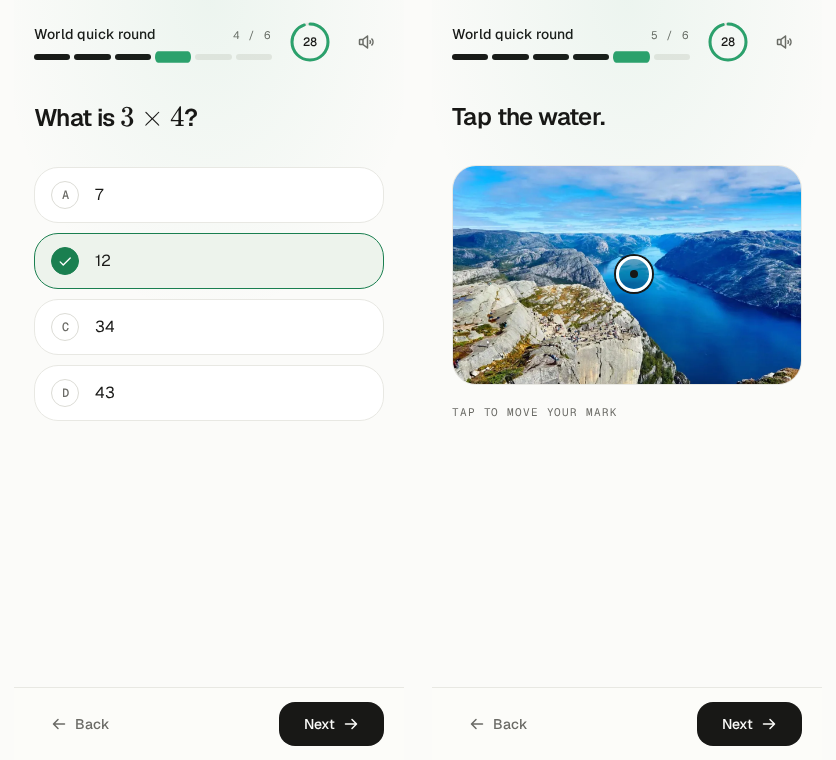
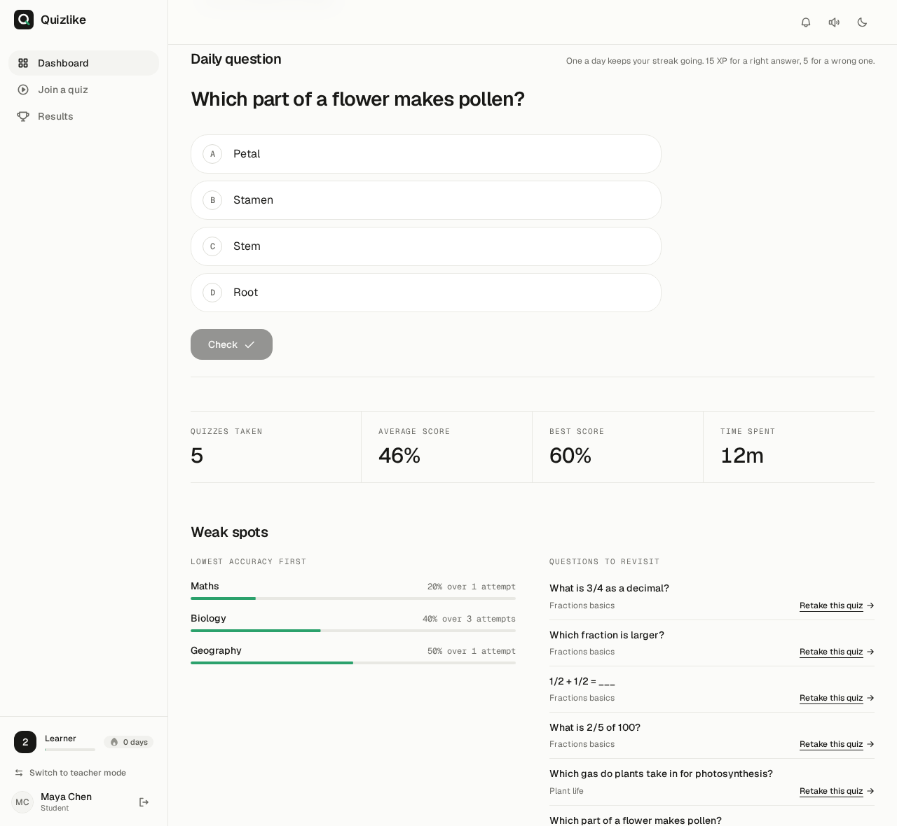
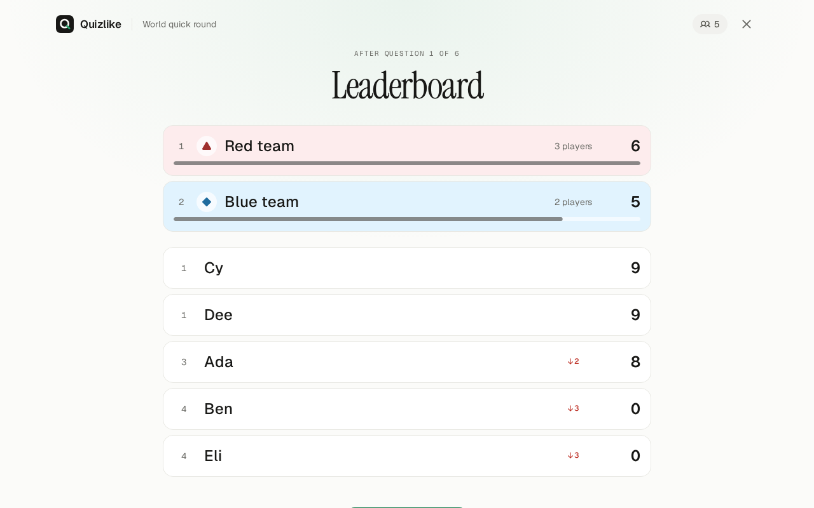
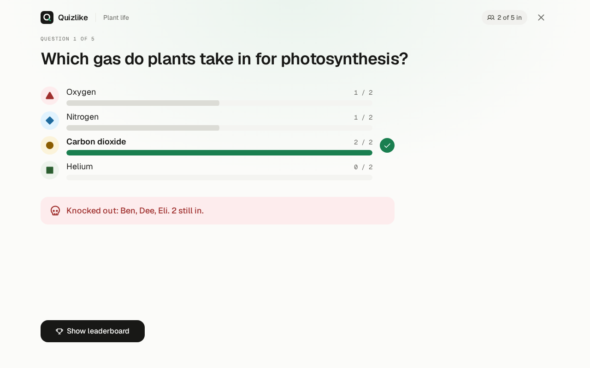
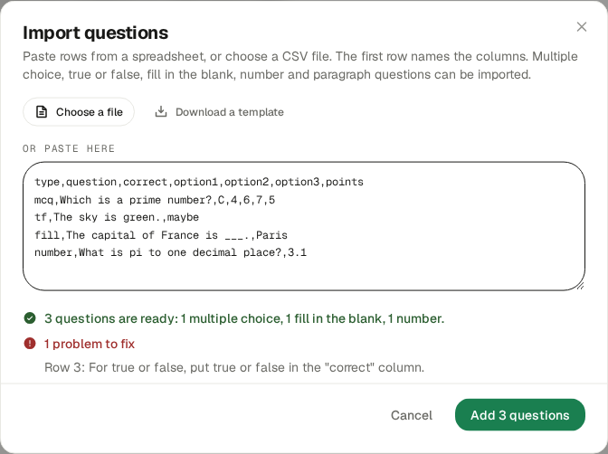
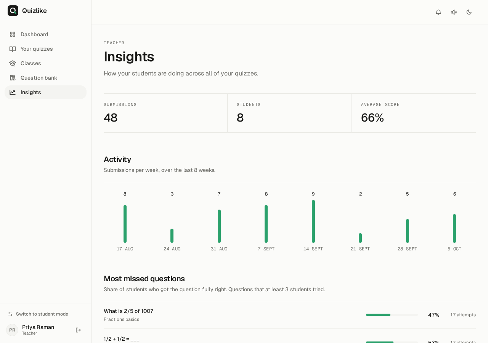

<div align="center">


# Quizlike

### Quizzes you actually want to finish.

Build a quiz once. Run it live on a projector, set it as homework,
or let anyone practise it on their own. Every quiz earns XP, builds a
streak and moves a bar.

[](https://quizlike.vercel.app)


</div>

---

## What it does

Most classroom quiz tools make you choose between a fast live game and a graded
assignment. Quizlike does both from the same quiz, and treats the quiz taker as
a player, not a form filler.

| For students | For teachers |
|---|---|
| Join with a code, no account needed | Eleven question types, with pictures, audio, video and maths |
| Earn XP, level up, keep a daily streak, collect badges | Host live games with power-ups, teams and sudden death |
| A daily question, and a list of your weak spots | Import questions from a spreadsheet |
| See every attempt, and review each answer | Insights across all your quizzes, and per quiz analytics |
| Rejoin a live game after a dropped signal | Classes, due dates, folders, and a queue for hand marking |

---

## Playing a quiz

One screen, one question. Answers respond instantly: options squeeze on press,
a check pops in, and the next question slides in. Everything works from the
keyboard too: `1` to `9` choose an option, `Enter` moves on.

<table>
<tr>
<td width="50%"></td>
<td width="50%"></td>
</tr>
</table>

### Eleven question types

| Type | How it works | Live games |
|---|---|:---:|
| Multiple choice | One answer or several, any number of options | yes |
| True or false | Two big targets | yes |
| Fill in the blank | Typed answer, several accepted spellings | yes |
| Match the following | Drag answers onto prompts, or tap and tap | yes |
| Reorder | Drag items into the right sequence | yes |
| Categorize | Sort items into groups | yes |
| Visual comprehension | A picture and follow up questions | yes |
| Listening comprehension | Audio or video and follow up questions | yes |
| Number | A number, with a tolerance and a unit. A comma or a point both work | yes |
| Click on the image | Tap the right place on a picture. Works from the keyboard too | yes |
| Paragraph | A written answer, marked by a teacher | no |

Match, Reorder and Categorize give partial credit, so three of four right is
worth three quarters of the marks. Pictures, audio and video can go on a
question and on each answer option. Write maths between dollar signs, like
`$x^2 + 1$`, and it is drawn as a real formula.



---

## It feels like a game

Nothing about progress needs setting up. XP, levels, streaks and badges are
worked out from the quizzes you finish.

<table>
<tr>
<td width="50%"></td>
<td width="50%"></td>
</tr>
</table>

- **XP** for every quiz, more for accuracy, a bonus for a perfect score. Your
  best attempt on each quiz counts, so a retake earns only the difference.
- **Levels** from Newcomer upward, with a bar that fills and overflows when you
  level up.
- **A daily streak**, kept alive until the end of the next day.
- **Eleven badges**, each with a progress bar while locked.
- Sound effects and confetti, with a switch to turn the sound off.

- **A daily question.** Every student gets the same one each day. Answering it
  keeps the streak alive and earns a little XP.
- **Weak spots.** The dashboard ranks your subjects by accuracy and lists the
  questions you missed, each with a link to retake that quiz.



Guests earn progress too. It stays on their device until they make an account.

---

## Live games

Put the code and a QR code on the projector. Students join on their phones.

<table>
<tr>
<td width="62%"></td>
<td width="38%"></td>
</tr>
</table>

- **One shared countdown.** A 3, 2, 1 starts every question on every screen at
  the same moment, even when phones have the wrong time.
- **Streak bonus.** Each right answer in a row adds 10% more points, up to 50%.
- **Power-ups.** Every player gets one 50/50 and one double points.
- **Rules chosen in the lobby.** Streak bonus, power-ups, shuffled questions
  and a lock on late joiners.
- **Teams.** Split the room into two, three or four teams. A team scores the
  average of its players, so a bigger team does not win by size.
- **Sudden death.** A wrong answer knocks a player out. The last one standing wins.
- **A pause button.** The clock stands still for everyone and gives back exactly
  the time that was left.
- **Come back any time.** A reload, a lost signal or a new phone keeps the
  player's seat and score.
- **A live board** that shows who moved up or down, and a podium at the end.
- **All the boards work live**, including Match, Reorder and Categorize, and
  media plays on each player's own device.

<table>
<tr>
<td width="50%"></td>
<td width="50%"></td>
</tr>
</table>

<table>
<tr>
<td width="33%"></td>
<td width="33%"></td>
<td width="33%"></td>
</tr>
</table>

---

## For teachers

<table>
<tr>
<td width="50%"></td>
<td width="50%"></td>
</tr>
</table>

- **A calm editor.** The open question is a card, the rest fold to one line.
  Save any question to a bank and reuse it in other quizzes. A quiz cannot be
  published with a question that has no right answer: the editor says which one.
- **Import from a spreadsheet.** Paste rows or choose a CSV file, see what was
  understood and which rows have problems, then add them.
- **A quiz library.** Duplicate a quiz, sort quizzes into folders, and let other
  teachers clone your open quizzes (or switch that off).
- **Insights.** Across all your quizzes: activity by week, the questions most
  students miss, and a student table with a trend arrow and a "needs help" filter.

<table>
<tr>
<td width="50%"></td>
<td width="50%"></td>
</tr>
</table>
- **Classes and assignments.** Invite students with a code, set due dates, see
  who has finished, and notify them when work is set.
- **Marking.** Everything is graded automatically except paragraphs, which go to
  a queue with partial credit.
- **Analytics.** Score spread, accuracy for each question, a sortable results
  table and a one click CSV export that is safe to open in a spreadsheet.
- **Live hosting** from the quiz list with one button.

---

## Your data

On the profile page anyone can download everything Quizlike holds about them as
one file, or delete their account. Deleting removes their results, class
memberships and notifications, and for a teacher their quizzes, classes and
question bank, then the profile and the sign in itself.

---

## Design

A warm off white page, near black ink, hairline borders and one green. Serif
headings, a clean sans for the interface and a mono face for numbers. Light is
the default and dark is a switch away. Animation uses only `transform` and
`opacity`, follows the system "reduce motion" setting, and is built from one
shared set of springs so every page moves the same way. Every page was checked
with axe-core in light and dark mode, and there is a skip to the content link.

---

## Tech stack

| Layer | Built with |
|---|---|
| Frontend | React 19, Vite 6, React Router 7 |
| Styling | Tailwind CSS v4, Radix primitives, Framer Motion, Phosphor icons |
| Type | Geist, Geist Mono and Instrument Serif, self hosted |
| Auth | Firebase Authentication: Google and email |
| Data | Cloud Firestore for quizzes and results, Realtime Database for live games |
| Media | ImageKit CDN, TUI Image Editor |
| Maths | KaTeX, downloaded only when a question has a formula |
| Hosting | Vercel: static files plus one serverless function |

Access is enforced by Firestore security rules. Some parts of the design lean on
the browser more than they should, and they are listed with a plan to fix them
in [docs/security.md](docs/security.md).

---

## Run it locally

```bash
git clone https://github.com/Haise-727/quiz-app.git
cd quiz-app
npm install --legacy-peer-deps
cp .env.local.example .env.local   # fill in the Firebase and ImageKit values
npm run dev                        # http://localhost:5173
```

`--legacy-peer-deps` is needed because `@toast-ui/react-image-editor` declares a
React 17 peer dependency but runs on React 19.

A blank page on first run almost always means a missing `VITE_*` value. See
`.env.local.example`.

The scoring, grading, import and progress rules are plain functions with their own tests:

```bash
npm test
```

To try the app with nothing real at stake, run the Firebase emulators on your own
computer (needs Java 17 or newer) and a copy of the app wired to them:

```bash
npm run emulators      # in one terminal
npm run dev:emulated   # in another, at http://localhost:5174
```

---

## Documentation

| | |
|---|---|
| [Technical reference](docs/technical.md) | Structure, design system, scoring rules, schemas |
| [Security review](docs/security.md) | What is weak today and how to fix it |
| [Moving to AWS](docs/aws-migration.md) | An optional plan, not under way |
| [Progress report](docs/progress-report.md) | What is built and what is left |
| [Contributing](docs/contributing.md) | Setup guide for new collaborators |
| [Project overview](PROJECT_OVERVIEW.md) | Why it is built the way it is |

---

## Team

| | |
|---|---|
| **Harsha Vardan M Sakamuri** | Frontend, backend, database, deployment |
| **Rakshith Shakkthi** | Frontend and UI, backend |

<div align="center">

**[Try it live](https://quizlike.vercel.app)**

</div>
