<div align="center">


# Quizlike

### Quizzes you actually want to finish.

Build a quiz once. Run it live on a projector, set it as homework,
or let anyone practise it on their own. Every quiz earns XP, builds a
streak and moves a bar.

[](https://quizlike.vercel.app)


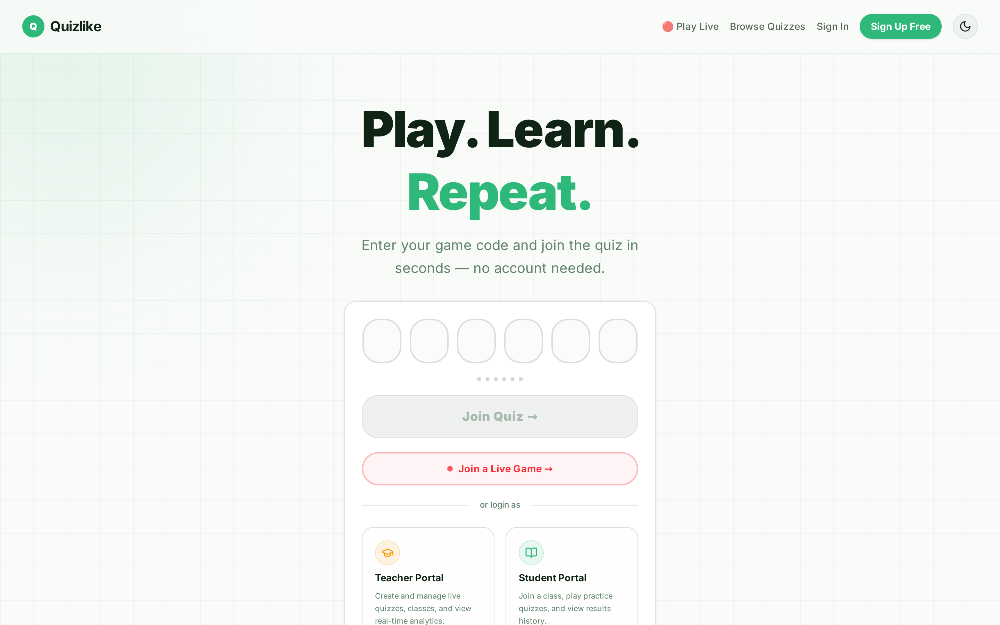

</div>

---

## What it does

Most classroom quiz tools make you choose between a fast live game and a graded
assignment. Quizlike does both from the same quiz, and treats the quiz taker as
a player, not a form filler.

| For students | For teachers |
|---|---|
| Join with a code, no account needed | Nine question types, with pictures, audio and video |
| Earn XP, level up, keep a daily streak, collect badges | Host live games with power-ups, streaks and a podium |
| See every attempt, and review each answer | Classes, due dates and a queue for hand marking |
| Join live games from a phone | Analytics per quiz and per question, with CSV export |

---

## Playing a quiz

One screen, one question. Answers respond instantly: options squeeze on press,
a check pops in, and the next question slides in. Everything works from the
keyboard too: `1` to `9` choose an option, `Enter` moves on.

<table>
<tr>
<td width="50%">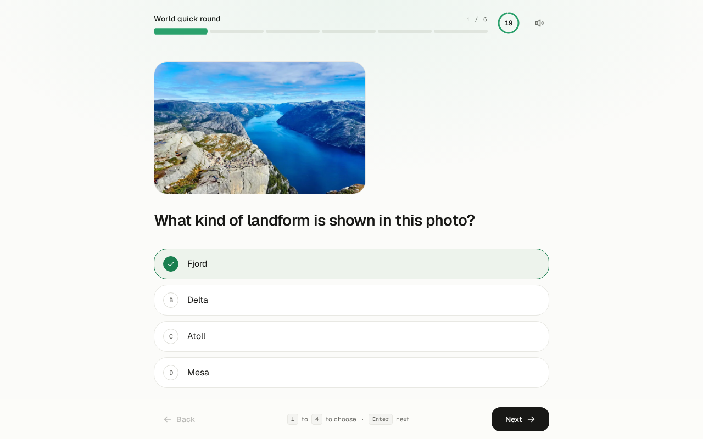</td>
<td width="50%">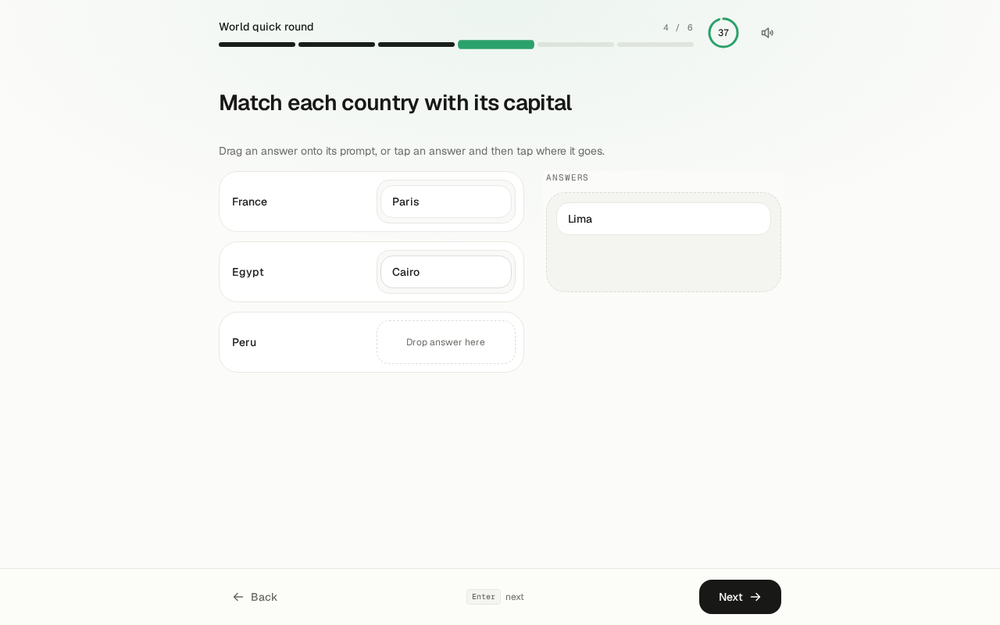</td>
</tr>
</table>

### Nine question types

| Type | How it works | Live games |
|---|---|:---:|
| Multiple choice | One answer or several, any number of options | yes |
| True or false | Two big targets | yes |
| Fill in the blank | Typed answer, several accepted spellings | yes |
| Match the following | Drag answers onto prompts, or tap and tap | yes |
| Reorder | Drag items into the right sequence | yes |
| Categorize | Sort items into groups | yes |
| Visual comprehension | A picture and follow up questions | yes |
| Listening comprehension | Audio or video and follow up questions | yes |
| Paragraph | A written answer, marked by a teacher | no |

Match, Reorder and Categorize give partial credit, so three of four right is
worth three quarters of the marks. Pictures, audio and video can go on a
question and on each answer option.

---

## It feels like a game

Nothing about progress needs setting up. XP, levels, streaks and badges are
worked out from the quizzes you finish.

<table>
<tr>
<td width="50%">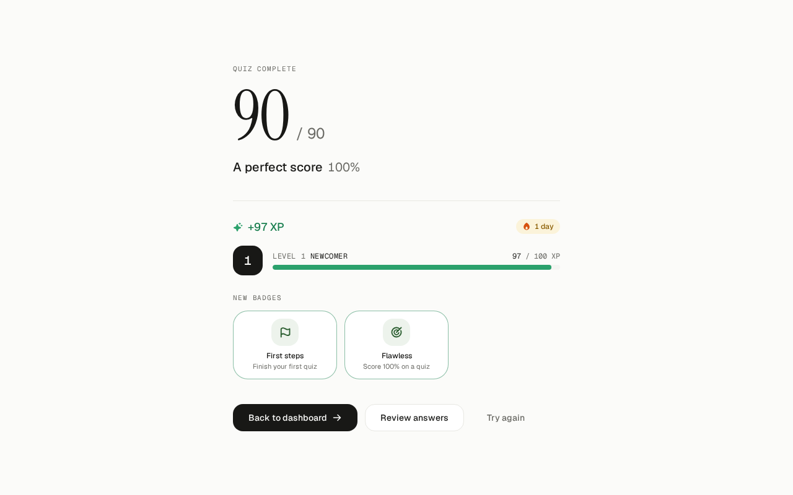</td>
<td width="50%">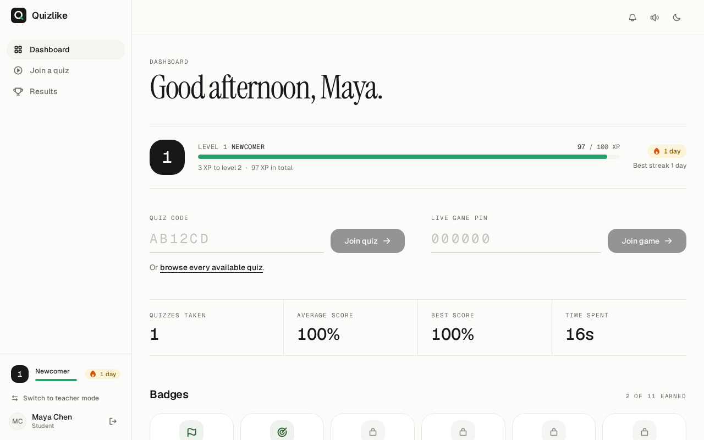</td>
</tr>
</table>

- **XP** for every quiz, more for accuracy, a bonus for a perfect score. Your
  best attempt on each quiz counts, so a retake earns only the difference.
- **Levels** from Newcomer upward, with a bar that fills and overflows when you
  level up.
- **A daily streak**, kept alive until the end of the next day.
- **Eleven badges**, each with a progress bar while locked.
- Sound effects and confetti, with a switch to turn the sound off.

Guests earn progress too. It stays on their device until they make an account.

---

## Live games

Put the code and a QR code on the projector. Students join on their phones.

<table>
<tr>
<td width="62%">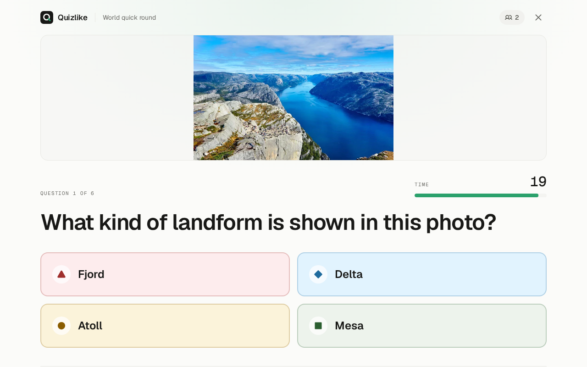</td>
<td width="38%">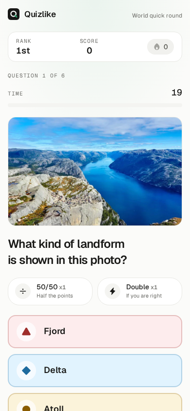</td>
</tr>
</table>

- **One shared countdown.** A 3, 2, 1 starts every question on every screen at
  the same moment, even when phones have the wrong time.
- **Streak bonus.** Each right answer in a row adds 10% more points, up to 50%.
- **Power-ups.** Every player gets one 50/50 and one double points.
- **Rules chosen in the lobby.** Streak bonus, power-ups, shuffled questions
  and a lock on late joiners.
- **A live board** that shows who moved up or down, and a podium at the end.
- **All the boards work live**, including Match, Reorder and Categorize, and
  media plays on each player's own device.

<table>
<tr>
<td width="33%">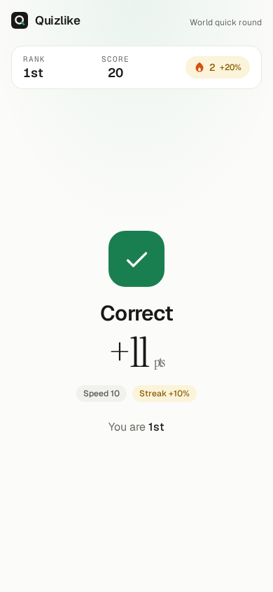</td>
<td width="33%">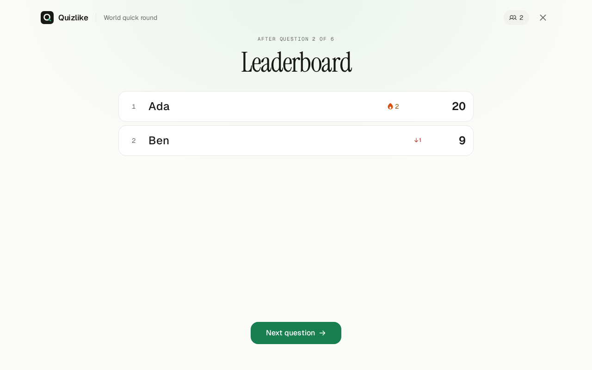</td>
<td width="33%">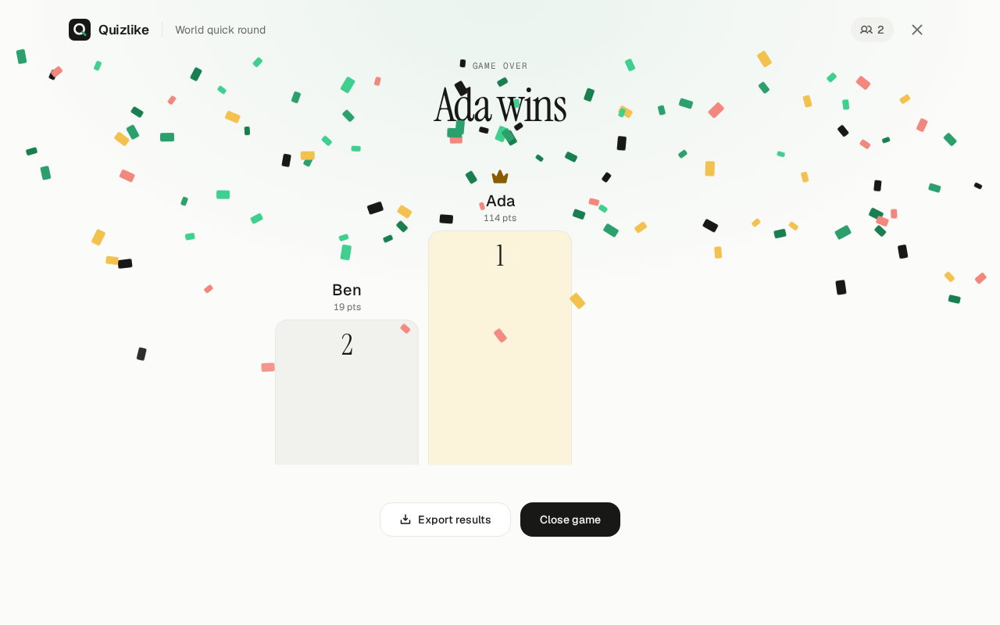</td>
</tr>
</table>

---

## For teachers

<table>
<tr>
<td width="50%">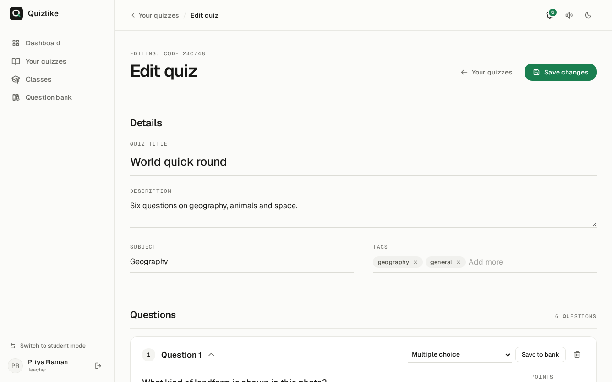</td>
<td width="50%">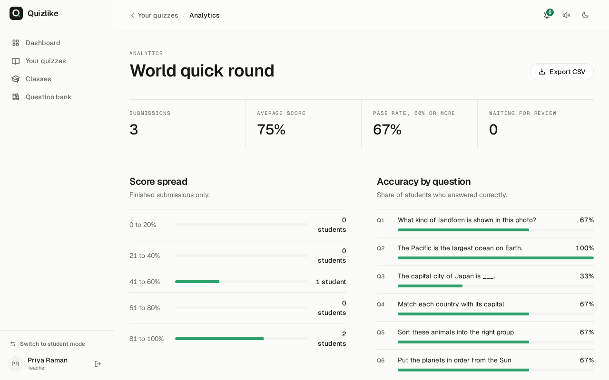</td>
</tr>
</table>

- **A calm editor.** The open question is a card, the rest fold to one line.
  Save any question to a bank and reuse it in other quizzes.
- **Classes and assignments.** Invite students with a code, set due dates, see
  who has finished, and notify them when work is set.
- **Marking.** Everything is graded automatically except paragraphs, which go to
  a queue with partial credit.
- **Analytics.** Score spread, accuracy for each question, a sortable results
  table and a one click CSV export that is safe to open in a spreadsheet.
- **Live hosting** from the quiz list with one button.

---

## Design

A warm off white page, near black ink, hairline borders and one green. Serif
headings, a clean sans for the interface and a mono face for numbers. Light is
the default and dark is a switch away. Animation uses only `transform` and
`opacity`, follows the system "reduce motion" setting, and is built from one
shared set of springs so every page moves the same way.

---

## Tech stack

| Layer | Built with |
|---|---|
| Frontend | React 19, Vite 6, React Router 7 |
| Styling | Tailwind CSS v4, Radix primitives, Framer Motion, Phosphor icons |
| Type | Geist, Geist Mono and Instrument Serif, self hosted |
| Auth | Firebase Authentication: Google and email |
| Data | Cloud Firestore for quizzes and results, Realtime Database for live games |
| Media | ImageKit CDN, TUI Image Editor |
| Hosting | Vercel: static files plus one serverless function |

Access is enforced by Firestore security rules. Some parts of the design lean on
the browser more than they should, and they are listed with a plan to fix them
in [docs/security.md](docs/security.md).

---

## Run it locally

```bash
git clone https://github.com/Haise-727/quiz-app.git
cd quiz-app
npm install --legacy-peer-deps
cp .env.local.example .env.local   # fill in the Firebase and ImageKit values
npm run dev                        # http://localhost:5173
```

`--legacy-peer-deps` is needed because `@toast-ui/react-image-editor` declares a
React 17 peer dependency but runs on React 19.

A blank page on first run almost always means a missing `VITE_*` value. See
`.env.local.example`.

The scoring, grading and progress rules are plain functions with their own tests:

```bash
node scripts/test-gamification.mjs
node scripts/test-quiz-attempt.mjs
node scripts/test-live-scoring.mjs
node scripts/test-csv.mjs
```

---

## Documentation

| | |
|---|---|
| [Technical reference](docs/technical.md) | Structure, design system, scoring rules, schemas |
| [Security review](docs/security.md) | What is weak today and how to fix it |
| [Moving to AWS](docs/aws-migration.md) | A plan to leave Firebase and Vercel |
| [Progress report](docs/progress-report.md) | What is built and what is left |
| [Contributing](docs/contributing.md) | Setup guide for new collaborators |
| [Project overview](PROJECT_OVERVIEW.md) | Why it is built the way it is |

---

## Team

| | |
|---|---|
| **Harsha Vardan M Sakamuri** | Frontend, backend, database, deployment |
| **Rakshith Shakkthi** | Frontend and UI, backend |

<div align="center">

**[Try it live](https://quizlike.vercel.app)**

</div>
