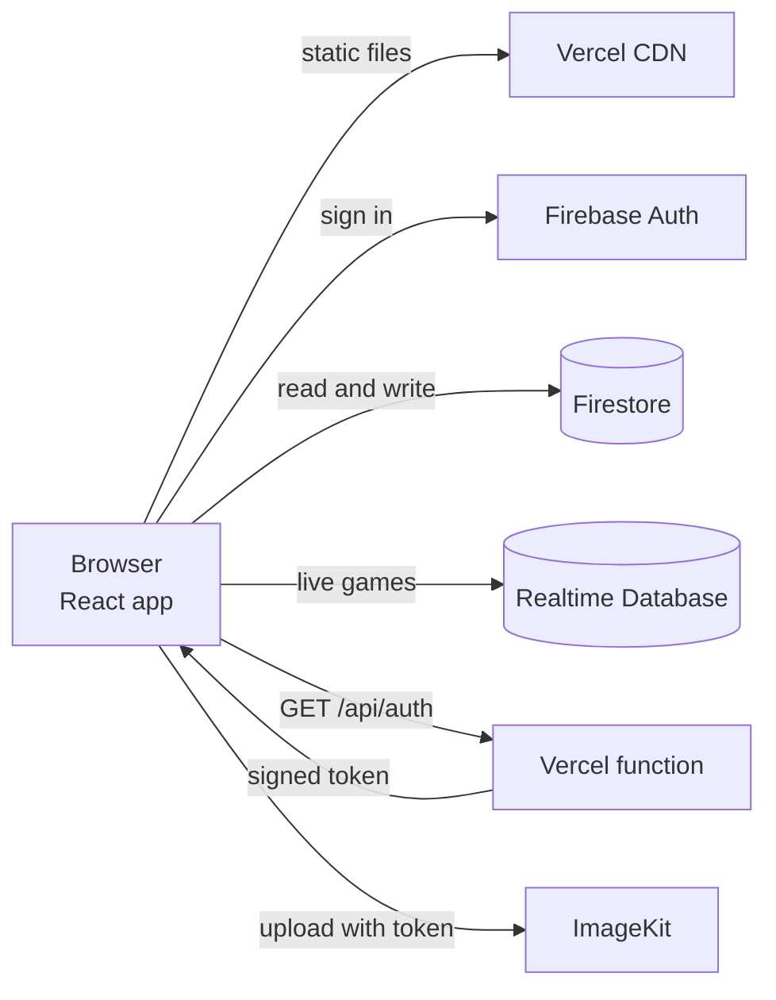
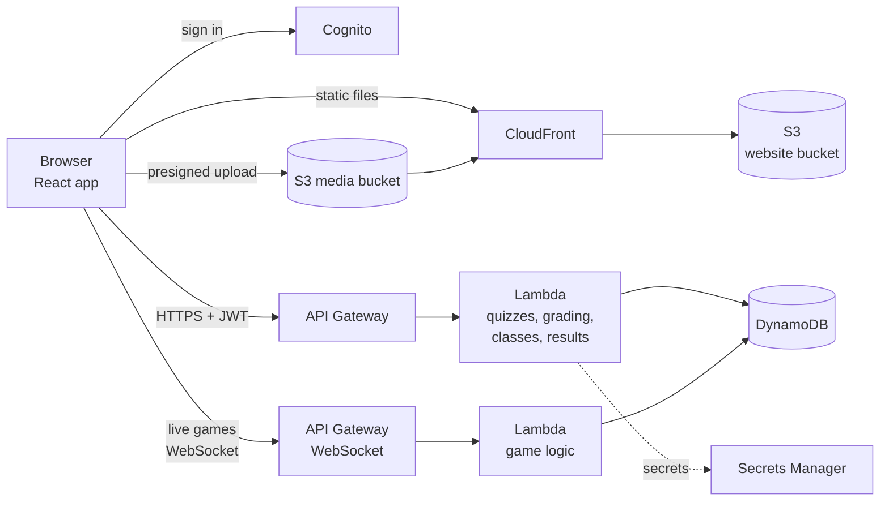

# Moving Quizlike to AWS

## The short answer

Yes, it is possible, and it is a reasonable plan. It is not a rewrite.

Today the browser talks straight to Firebase. There is no server of our own
except one small function on Vercel. Moving to AWS means building the missing
piece, a real API, and putting each Firebase service behind it one at a time.
That same API is also what fixes the security problems in
[security.md](security.md), so the work pays off twice.

Do it in small steps, with the old system running the whole time. Never switch
everything in one night.

## Where we are today

How tightly the app is tied to Firebase, counted from the code:

- 26 of the 61 source files import Firebase.
- 17 pages call Firestore directly, with about 70 calls in total (27 list reads,
  15 single reads, 11 updates, 8 adds, 7 deletes, 1 batch write).
- Only two places use live listeners: the live game session and the
  notification bell. Every other screen reads once.

The last point is good news. Real time is the hardest thing to move, and we need
it in only two places.

## Where we want to be

Everything in the middle is serverless. There are no servers to patch and the bill
is close to zero when nobody is using it.

## Service by service

| Today | On AWS | Notes |
|---|---|---|
| Vercel static hosting | S3 plus CloudFront (or Amplify Hosting) | CloudFront needs a rewrite so every path returns `index.html`, the same job `vercel.json` does now. |
| Vercel function `/api/auth` | Lambda behind API Gateway | Becomes one route of a bigger API. |
| Firebase Auth | Amazon Cognito user pool | Email and password, plus Google as a federated sign in. Roles become Cognito groups. |
| Firestore | DynamoDB | See the choice below. |
| Realtime Database (live games) | API Gateway WebSocket plus Lambda plus DynamoDB | The server runs the game, so no player writes a score. |
| ImageKit | Keep it at first, move to S3 plus CloudFront later | ImageKit is not tied to Firebase. Keeping it is the lowest risk. |
| Vercel environment variables | Secrets Manager or SSM Parameter Store | |
| Vercel auto deploys | GitHub Actions with an OIDC role | No long lived AWS keys in GitHub. |
| Vercel logs | CloudWatch Logs, metrics and alarms | Add a cost budget alarm on day one. |
| Nothing | AWS WAF on CloudFront | Rate limits and basic abuse rules. |
| Nothing | Infrastructure as code with CDK in TypeScript | Everything above is created from the repository. |

### Choosing the database

There are two sensible choices.

**DynamoDB.** Cheapest, scales to zero, and fits because the app only asks a
handful of questions: a quiz by id, quizzes by owner, results by quiz, results by
student, a class by code, enrolments by class or student, notifications by user.
Each of those is a key lookup. Quiz questions are nested documents, which suits
DynamoDB. Reports and the CSV export can read from it directly or from an
export to Athena.

**Aurora PostgreSQL or RDS.** Better if the team wants to write ad hoc reporting
queries and joins. It costs more, because there is always a minimum database
running.

Our recommendation is DynamoDB, with one table per collection at first so the
move mirrors what exists today. It can be reshaped later once it works.

### Choosing the real time layer

| Option | Good | Bad |
|---|---|---|
| API Gateway WebSocket plus Lambda | Fully serverless, familiar, easy to put the game rules on the server | You manage connection ids yourself |
| AppSync subscriptions | Closest to "listen to this path" | Needs GraphQL |
| IoT Core over MQTT | Very cheap fan out | Odd auth setup, odd for a quiz app |
| Redis plus a small container | Fastest | A server to run, which we wanted to avoid |

Our recommendation is the API Gateway WebSocket. The game logic moves into a
Lambda that checks the answer, scores it and broadcasts the result. That is the
fix for the open live game database in the security review.

## How to do it safely

Use the strangler pattern. Build the new system around the old one, move one
piece at a time, and keep a way back at every step.

**Step 0. Put a layer between the pages and Firebase (a few days).**
Today 17 pages call Firestore directly. Create `src/api/` with plain functions
such as `getQuiz(id)`, `listMyQuizzes()` and `submitResult(...)`. Move every
Firestore call behind it. Nothing visible changes. This is the most important
step, because afterwards the backend can change without touching a page.

**Step 1. Hosting and the signer, with Firebase still behind (2 to 3 days).**
Create the AWS account structure, the CDK project and the GitHub Actions
pipeline. Serve the React app from S3 and CloudFront. Move `/api/auth` to a
Lambda that checks the user's token. The app now runs on AWS, yet the data and
sign in are still Firebase. This proves the pipeline end to end at low risk.

**Step 2. The API and the data, one collection at a time (1 to 2 weeks).**
Build the quiz, results and classes endpoints on Lambda and DynamoDB. Grading
moves to the server here, which also hides the answer keys. Switch the pages one
at a time by changing the function inside `src/api/`. Copy existing data with a
script that reads Firestore through the admin SDK and writes DynamoDB, then
compare counts before cutting over.

**Step 3. Sign in (3 to 5 days).**
Create the Cognito pool. Firebase cannot export passwords in a form Cognito
accepts, so use lazy migration: a Cognito trigger checks the old Firebase
password the first time each person signs in and then stores it in Cognito.
Nobody has to reset a password. Roles become groups.

**Step 4. Live games (1 week).**
Build the WebSocket API and the game Lambda, move the session state to DynamoDB
with a time to live so finished games clean themselves up, and point
`liveSession.js` at it. Then switch off the Realtime Database.

**Step 5. Notifications.**
The bell is the second live listener. A short polling interval is enough, or the
same WebSocket can carry it.

**Step 6. Cut over and retire.**
Point the domain at CloudFront with Route 53 and ACM. Keep the Firebase project
for a few weeks as a fallback, then export what is left and shut it down.

Each step ends with a working app, and each can be switched back with an
environment setting.

## What it costs

Rough numbers for a classroom sized app. Check the AWS pricing calculator for
current prices, because they change.

| Piece | Cost at demo or class scale |
|---|---|
| S3, CloudFront | a few cents to a few dollars |
| Lambda and API Gateway | inside the free tier for a long while |
| DynamoDB on demand | cents |
| Cognito | free for the first 10,000 monthly users |
| WebSocket messages | cents per million |
| Secrets Manager | about 0.40 dollars per secret per month |
| WAF | about 5 to 10 dollars a month, the only fixed cost worth noting |

Expect well under 20 dollars a month for a real classroom, and close to nothing
when idle. Aurora would add a fixed 40 dollars or more a month, which is why we
lean to DynamoDB.

## What could go wrong

- **Cognito has its own quirks.** Token customisation, the hosted pages and
  password rules differ from Firebase. Budget time to learn it.
- **DynamoDB rewards planning.** List the queries first. Adding a new kind of
  query later can mean a new index.
- **Lambda cold starts** add a short delay to the first request after a quiet
  period. It is fine for this app, and provisioned concurrency exists if needed.
- **WebSocket connections drop.** The client needs to reconnect and ask for the
  current game state, which a Firebase listener did for us.
- **Two systems run together for a while.** Keep one source of truth for each
  collection at any moment, and move collections one at a time.

## The fastest convincing first step

If the goal is to show it works, do Step 0 and Step 1. In about a week the app is
served from S3 and CloudFront, built and deployed by GitHub Actions from CDK, with
a Lambda that verifies the user before it signs an upload. Firebase still holds
the data, so nothing is at risk, and it already shows infrastructure as code,
CI and CD with no stored keys, a serverless API and least privilege IAM.

## Decisions to make before starting

1. DynamoDB or PostgreSQL.
2. Keep ImageKit, or move media to S3.
3. CDK or Terraform. CDK in TypeScript fits a JavaScript team.
4. One AWS account or separate development and production accounts. Separate
   accounts are better and cost nothing extra.
