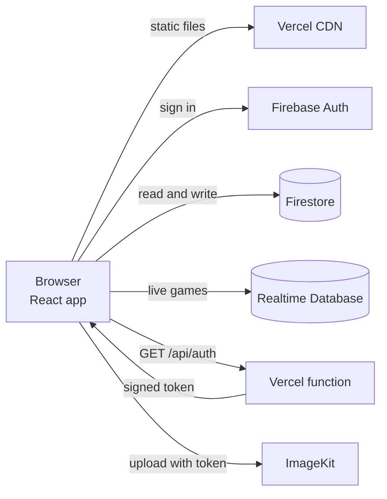
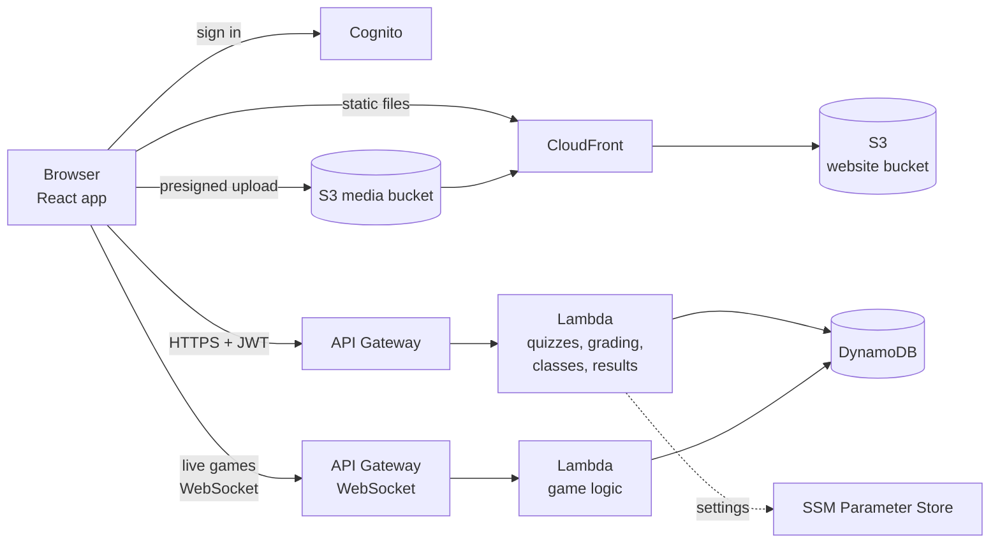

# Moving Quizlike to AWS

> **Status: not under way.** The owner looked at this in October 2026 and decided not to
> move. It is kept as a reference in case a server of our own is wanted later. The
> Free plan section describes how AWS's free tier really works, which is worth knowing
> before trying any AWS service.

## The short answer

Yes, it is possible, and it is a reasonable plan. It is not a rewrite.

Today the browser talks straight to Firebase. There is no server of our own
except one small function on Vercel. Moving to AWS means building the missing
piece, a real API, and putting each Firebase service behind it one at a time.
That same API is also what fixes the security problems in
[security.md](security.md), so the work pays off twice.

Do it in small steps, with the old system running the whole time. Never switch
everything in one night.

## The rule that shapes everything: the Free plan lasts six months

Checked against the AWS documentation in October 2026.

- A new AWS account can pick the **Free plan**. It gives 100 dollars of credit
  at sign up and up to 100 more for finishing small tasks. While you are on it,
  **AWS cannot charge you**. Services that could burn the credits in one go are
  simply blocked.
- The Free plan ends after **6 months, or when the credits run out, whichever
  comes first**. It cannot be extended. The account then **closes**. AWS keeps
  the data for 90 days, and you can upgrade to the Paid plan in that window to
  get it back. After 90 days it is deleted for good.
- Upgrading keeps any credits left over. They expire 12 months after the account
  was created.
- Over 30 services are **Always Free** inside monthly limits, on both plans. The
  ones we need are listed below.
- Some things end the Free plan at once and turn the account into a Paid one:
  joining AWS Organizations, setting up Control Tower, joining the Partner
  Network, or signing up for an Enterprise Agreement. IAM Identity Center is
  also reported to do it. **Avoid all of them**, which is why this plan uses one
  account and plain IAM users.

So the Free plan is a six month sandbox, not permanent hosting. The honest
choices at the end are in "When the six months are up" below.

## Where we are today

How tightly the app is tied to Firebase, counted from the code:

- 26 of the 61 source files import Firebase.
- 17 pages call Firestore directly, with about 70 calls in total (27 list reads,
  15 single reads, 11 updates, 8 adds, 7 deletes, 1 batch write).
- Only two places use live listeners: the live game session and the
  notification bell. Every other screen reads once.

The last point is good news. Real time is the hardest thing to move, and we need
it in only two places.

## Where we want to be

Everything in the middle is serverless. There are no servers to patch and the bill
is close to zero when nobody is using it.

## Service by service

| Today | On AWS | Notes |
|---|---|---|
| Vercel static hosting | S3 plus CloudFront (or Amplify Hosting) | CloudFront needs a rewrite so every path returns `index.html`, the same job `vercel.json` does now. |
| Vercel function `/api/auth` | Lambda behind API Gateway | Becomes one route of a bigger API. |
| Firebase Auth | Amazon Cognito user pool | Email and password, plus Google as a federated sign in. Roles become Cognito groups. |
| Firestore | DynamoDB | See the choice below. |
| Realtime Database (live games) | API Gateway WebSocket plus Lambda plus DynamoDB | The server runs the game, so no player writes a score. |
| ImageKit | Keep it at first, move to S3 plus CloudFront later | ImageKit is not tied to Firebase. Keeping it is the lowest risk. |
| Vercel environment variables | SSM Parameter Store, standard parameters | Free. Secrets Manager costs about 0.40 dollars per secret per month, so skip it. |
| Vercel auto deploys | GitHub Actions with an OIDC role | No long lived AWS keys in GitHub. |
| Vercel logs | CloudWatch Logs, metrics and alarms | Set log retention to 7 days. Add a cost budget alarm on day one. |
| Nothing | Infrastructure as code with CDK in TypeScript | Everything above is created from the repository. |

### Choosing the database

There are two sensible choices.

**DynamoDB.** Cheapest, scales to zero, and fits because the app only asks a
handful of questions: a quiz by id, quizzes by owner, results by quiz, results by
student, a class by code, enrolments by class or student, notifications by user.
Each of those is a key lookup. Quiz questions are nested documents, which suits
DynamoDB. Reports and the CSV export can read from it directly or from an
export to Athena.

**Aurora PostgreSQL or RDS.** Better if the team wants to write ad hoc reporting
queries and joins. It costs more, because there is always a minimum database
running.

Our recommendation is DynamoDB, with one table per collection at first so the
move mirrors what exists today. It can be reshaped later once it works.

### Choosing the real time layer

| Option | Good | Bad |
|---|---|---|
| API Gateway WebSocket plus Lambda | Fully serverless, familiar, easy to put the game rules on the server | You manage connection ids yourself |
| AppSync subscriptions | Closest to "listen to this path" | Needs GraphQL |
| IoT Core over MQTT | Very cheap fan out | Odd auth setup, odd for a quiz app |
| Redis plus a small container | Fastest | A server to run, which we wanted to avoid |

Our recommendation is the API Gateway WebSocket. The game logic moves into a
Lambda that checks the answer, scores it and broadcasts the result. That is the
fix for the open live game database in the security review.

## How to do it safely

Use the strangler pattern. Build the new system around the old one, move one
piece at a time, and keep a way back at every step.

**Step 0. Put a layer between the pages and Firebase (a few days).**
Today 17 pages call Firestore directly. Create `src/api/` with plain functions
such as `getQuiz(id)`, `listMyQuizzes()` and `submitResult(...)`. Move every
Firestore call behind it. Nothing visible changes. This is the most important
step, because afterwards the backend can change without touching a page.

**Step 1. Hosting and the signer, with Firebase still behind (2 to 3 days).**
Create the AWS account (Free plan, see above), the CDK project and the GitHub
Actions pipeline. Serve the React app from S3 and CloudFront. Move `/api/auth` to a
Lambda that checks the user's token. The app now runs on AWS, yet the data and
sign in are still Firebase. This proves the pipeline end to end at low risk.

**Step 2. The API and the data, one collection at a time (1 to 2 weeks).**
Build the quiz, results and classes endpoints on Lambda and DynamoDB. Grading
moves to the server here, which also hides the answer keys. Switch the pages one
at a time by changing the function inside `src/api/`. Copy existing data with a
script that reads Firestore through the admin SDK and writes DynamoDB, then
compare counts before cutting over.

**Step 3. Sign in (3 to 5 days).**
Create the Cognito pool. Firebase cannot export passwords in a form Cognito
accepts, so use lazy migration: a Cognito trigger checks the old Firebase
password the first time each person signs in and then stores it in Cognito.
Nobody has to reset a password. Roles become groups.

**Step 4. Live games (1 week).**
Build the WebSocket API and the game Lambda, move the session state to DynamoDB
with a time to live so finished games clean themselves up, and point
`liveSession.js` at it. Then switch off the Realtime Database.

**Step 5. Notifications.**
The bell is the second live listener. A short polling interval is enough, or the
same WebSocket can carry it.

**Step 6. Cut over and retire.**
Point the domain at CloudFront with Route 53 and ACM. Keep the Firebase project
for a few weeks as a fallback, then export what is left and shut it down.

Each step ends with a working app, and each can be switched back with an
environment setting.

## Free plan edition: what runs where, and why the bill stays at zero

The aim is that **running out of free allowance makes something slow down or
stop, and never makes something cost money.** Each choice below follows that.

| Part | Service | Free allowance | Why it cannot surprise you |
|---|---|---|---|
| Web hosting | S3 plus CloudFront on the **Free flat rate plan** | 1 million requests and 100 GB a month, 0 dollars | The flat rate plans have **no overage charges**. Past the allowance, service may degrade. It does not bill |
| API | Lambda with Function URLs | 1 million requests and 400,000 GB seconds a month, always free | Set **reserved concurrency** to a small number, so a flood is rejected instead of paid for |
| Database | DynamoDB in **provisioned** mode | 25 GB, 25 read and 25 write units, always free | Provisioned capacity **throttles** when full. On demand mode bills per request, so do not use it |
| Sign in | Cognito, Lite or Essentials tier | 10,000 monthly users, always free | Never turn on the Plus tier, which has no free allowance |
| Live games | API Gateway WebSocket plus Lambda | Covered by Free plan credits for 6 months | Afterwards about 1 dollar per million messages and 0.25 dollars per million connection minutes. A 30 player game is a fraction of a cent. Set stage throttling |
| Settings | SSM Parameter Store, standard | Free | Not Secrets Manager |
| Images and audio | Keep ImageKit at first. Later S3 with presigned upload | S3 storage is cents a month for a few GB | Lifecycle rule to expire old test files |
| Infrastructure | CDK in TypeScript | Free, a few cents of S3 for its bootstrap bucket | Everything is deleted with one command |
| Deploys | GitHub Actions with an OIDC role | Free for a public repository | No AWS keys stored in GitHub |

### Things that cost money without warning. Do not create these

| Trap | Cost |
|---|---|
| NAT Gateway | about 32 dollars a month, plus data |
| Application or Network Load Balancer | about 16 dollars a month |
| EC2, RDS, Aurora, ElastiCache | hourly, and some are blocked on the Free plan anyway |
| A public IPv4 address, including an unused Elastic IP | about 3.60 dollars a month each |
| Route 53 hosted zone | 0.50 dollars a month, plus about 12 dollars a year for a domain. Use the CloudFront address instead |
| Secrets Manager secret | about 0.40 dollars a month each |
| KMS customer key | 1 dollar a month each |
| AWS WAF | about 5 dollars a month and more. Skip it |
| CloudWatch Logs with no retention | grows for ever. Set 7 days |
| Cognito Plus tier, Bedrock, SageMaker, anything "AI" | per use, no free allowance |

### Guardrails to set before anything else

1. **A hard cap outside AWS.** Pay for the account with a virtual or prepaid card
   that has a low spending limit. That is the one protection AWS cannot get wrong.
2. A **Budget** of 1 dollar with email alerts at 50, 80 and 100 percent, and a
   second at 5 dollars.
3. **Billing and Free Tier alerts** switched on in the billing preferences.
4. Reserved concurrency on every Lambda, throttling on the WebSocket stage, and
   DynamoDB capacity fixed at the free 25 and 25 with no autoscaling.
5. MFA on the root user, then never use root again. Deploy with an IAM user
   that has only what CDK needs. Do not create access keys for root.
6. A weekly look at the Billing console during the first month.

### When the six months are up

| Choice | What happens | Cost |
|---|---|---|
| **Upgrade to Paid and stay on Always Free services** | The app keeps running. Leftover credits apply until month 12. After that the bill is only what goes beyond the allowances, which for a class sized app is cents | Close to 0 dollars, with the guardrails above and a card limit |
| **Let it close** | Everything is switched off. Data is kept for 90 days | 0 dollars |
| **Fall back to Firebase and Vercel** | They keep running throughout, because we move one piece at a time and never switch off the old system until the end | 0 dollars |

The way to waste the least of the six months: **do not open the AWS account until
the code is ready.** Steps 0 and the Lambda code can be written and tested on a
laptop with DynamoDB Local, so the clock only starts when there is something to
deploy.

## What it costs

On the Free plan, nothing. After it, for a classroom sized app, expect cents a
month if the guardrails above are in place. The bigger numbers that appear in
older guides come from services this plan avoids: a WAF, load balancers, a NAT
gateway, a database server, and Secrets Manager.

## What could go wrong

- **Cognito has its own quirks.** Token customisation, the hosted pages and
  password rules differ from Firebase. Budget time to learn it.
- **DynamoDB rewards planning.** List the queries first. Adding a new kind of
  query later can mean a new index.
- **Lambda cold starts** add a short delay to the first request after a quiet
  period. It is fine for this app, and provisioned concurrency exists if needed.
- **WebSocket connections drop.** The client needs to reconnect and ask for the
  current game state, which a Firebase listener did for us.
- **Two systems run together for a while.** Keep one source of truth for each
  collection at any moment, and move collections one at a time.

## The fastest convincing first step

If the goal is to show it works, do Step 0 and Step 1. In about a week the app is
served from S3 and CloudFront, built and deployed by GitHub Actions from CDK, with
a Lambda that verifies the user before it signs an upload. Firebase still holds
the data, so nothing is at risk, and it already shows infrastructure as code,
CI and CD with no stored keys, a serverless API and least privilege IAM.

## Decisions to make before starting

1. DynamoDB or PostgreSQL.
2. Keep ImageKit, or move media to S3.
3. CDK or Terraform. CDK in TypeScript fits a JavaScript team.
4. One AWS account only. Separate development and production accounts need AWS
   Organizations, which ends the Free plan at once. Use two CDK stacks with
   different name prefixes in the same account instead.
